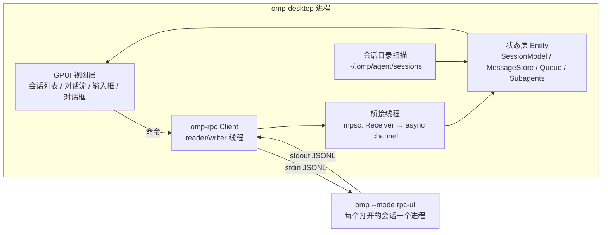

# omp-desktop 技术方案

目标：用 Rust 写一个 omp 的桌面客户端。agent 核心（模型调用、工具、会话持久化）全部由本机 `omp` 进程提供，客户端只负责界面和交互。

调研基于 omp v18.13.3（`/opt/homebrew/bin/omp`）和 oh-my-pi 仓库 `main@b075692`（2026-10-29）；实施时 `omp-rpc` 以 tag `v18.13.3` 为准。

## 1. 对接方式选型

omp 对外有三种接入面：

| 接入面 | 形式 | 功能覆盖 | 结论 |
| --- | --- | --- | --- |
| `omp --mode rpc` / `rpc-ui` | stdio 上的 JSONL，omp 自定义协议 v1/v2 | 全量：prompt/steer/follow-up 队列、abort、模型/思考档位、compact、fork/branch/tree、子 agent 订阅与 steer、todo、goal、btw、login/logout、ask/approval 对话框、host tools/URI、听写、补全 | **采用** |
| `omp acp` | Agent Client Protocol（Zed 等编辑器用） | 通用子集；审批策略只能按进程配置，没有子 agent、队列、tree 等 omp 特有能力 | 不采用 |
| SDK（TS 嵌入） | 进程内 | 需要 Bun/Node 运行时 | 与 Rust 客户端不匹配 |

官方已有 Rust 客户端 crate `omp-rpc`（`sdk/rust/omp-rpc`）：

- `wire.rs` 由协议 schema 生成（7.3k 行），每条命令一个 `XxxCommand` 结构体，未知帧解码成 `Unknown(Value)`，omp 新增事件时不会把客户端打挂。
- `client.rs` 是阻塞式传输层：自动协商 v2、重组 `rpc_chunk` 分片、按 id 关联响应、`prompt_and_wait`、分页拉取消息、host tool / host URI 分发、进程组回收（SIGTERM → 1s 后 SIGKILL）。
- 事件通过 `std::sync::mpsc::Receiver<Event>` 交给调用方。
- 依赖只有 serde、serde_json、libc；`publish = false`，没有发布到 crates.io。

**已验证**：在本机用该 crate 拉起 `omp --mode rpc-ui --no-session`，协商到 protocol v2，`get_state` 返回当前模型 `auto/claude-opus-5.5` 和 sessionId，用时约 26s（含编译）。

### 依赖引入方式

直接写 git 依赖会克隆整个 oh-my-pi monorepo，本机 600s 没克隆完。改用 sparse checkout 只拉 `sdk/rust/omp-rpc`（约 5s），作为 vendored 依赖放进 `vendor/omp-rpc`，并在 `vendor/omp-rpc/UPSTREAM` 里记录上游 tag 和 commit。

**必须从与已安装 omp 一致的 release tag 拉取，不能用 `main`**。已核对：`v18.13.3`（`413d278`）和 `main@b075692` 之间，`wire.rs` 多了 38 行，用 `main` 会和本机 omp 的协议不一致。拉取命令：

```bash
git clone --depth 1 --filter=blob:none --sparse --branch v18.13.3 https://github.com/can1357/oh-my-pi
git -C oh-my-pi sparse-checkout set sdk/rust/omp-rpc
```

升级 omp 时，按新 tag 重新拉取这个目录。

## 2. UI 框架选型

| 方案 | 优点 | 风险 |
| --- | --- | --- |
| **GPUI + gpui-kit 0.7**（推荐） | 纯 Rust；Zed 在生产中验证过；gpui-kit 提供 75+ 组件，包括 Markdown/HTML 渲染、Tree-sitter 代码高亮、虚拟列表、Dock 布局、主题、AccessKit；输入框 IME 有专门修复；剥离调试信息后二进制约 4.3 MiB | 1.0 之前 API 变动频繁，需要锁版本；Windows 平台 IME 支持较粗糙；文档比 Web 生态少 |
| Tauri 2 | Markdown、diff、代码高亮直接用 Web 生态的现成库，开发最快 | UI 层是 HTML/JS，不算纯 Rust 技术栈；Linux 依赖 WebKitGTK |
| Slint / iced / egui | 纯 Rust | 富文本、Markdown、长对话流的组件都要自己实现：egui 不支持段落级双向文本排版，iced 缺少无障碍支持 |

决策：选 **GPUI + gpui-kit**。理由是聊天流、Markdown、代码块、diff、虚拟列表正好是 gpui-kit 的强项，而且符合"Rust 技术栈"的要求。如果 M1 原型发现中文 IME 或长对话渲染达不到要求，退回 Tauri 2：传输层和状态层两个 crate 与 UI 无关，可以原样复用。

**结论（M1 后）**：用户在真实窗口里手动验证了中文输入法（拼音候选、Enter 上屏不误发送），通过，保留 GPUI，不再考虑退回 Tauri。

## 3. 架构



### 3.1 进程模型

- 每个打开的会话 tab 对应一个 `omp --mode rpc-ui` 子进程，启动时用 `--cwd <workspace>`；恢复会话用 `--resume <path>` 或 `switch_session`。
- 一个进程同一时刻只绑定一个会话。多 tab 并行跑任务需要多个进程，这和 TUI 的使用方式一致。
- 关闭 tab 时调用 `Client::close()`，由它回收整个进程组。bash 工具放到后台的任务属于独立进程组，不会被回收；这是 omp 本身的行为，文档里要说明。
- 进程意外退出（`Error::Closed`）后，tab 显示"已断开"，并提供"重连"按钮：以 `--resume <sessionFile>` 重新拉起。

### 3.2 线程与异步

`omp-rpc` 是阻塞 API，GPUI 是单线程 UI 加 executor：

- 每个会话起一个专用桥接线程，循环 `events.recv()`，把事件转发到 `async_channel`；UI 侧用 `cx.spawn` 消费，再调用 `entity.update(...)`。
- 命令调用（`client.call`）放在 `cx.background_executor()` 上执行，结果回到 UI 线程。`Client` 内部用锁和 channel 实现，可以跨线程共享（用 `Arc` 包装）。
- 不引入 tokio，GPUI 自带的 executor 足够。

### 3.3 流式消息

- 启动后发送 `set_event_filter { events: null, messageUpdates: "delta" }`：`message_update` 只带增量，不再每帧附带完整消息快照，长回复的流量从 O(n²) 降到 O(n)。
  - 生成的 `SetEventFilterCommand` 只有 `events` 字段，没有 `messageUpdates`。`Command` trait 是公开的，在 `omp-bridge` 里自己定义一个 `SetEventFilterDelta` 实现它即可（约 15 行，输出类型用 `serde_json::Value`），不需要 patch vendored crate。
  - 支持检测：响应里有 `data.messageUpdates == "delta"` 才走增量重建；没有这个字段说明是旧版 omp，回退到完整快照。
  - 已验证（tag `v18.13.3` 的 crate，对本机 omp 18.13.3，同一个 prompt 分别跑完整快照和增量两种模式）：两种模式下事件种类和数量一致，没有出现 `Event::Undecodable`。增量模式下 `message_update` 的 `message` 只有 `{role}`，能正常解码成 `AgentMessage`，因为生成的消息类型是 open record。实测一帧从 1378 字节降到 173 字节。
- 增量重建规则按协议文档实现：`*_start` 的 `block` 是空壳，`text_delta` / `thinking_delta` 追加内容，`toolcall_end` 给出完整工具调用，**`message_end` 是最终权威**，收到后整体替换。
- 消息按 `messageId` 作为 key。`agent_end.messages` 可能被压缩掉前缀，以已经收到的 `message_end` 为准。
- 回合是否结束看 `prompt_result`；整个会话是否空闲看 `session_settled`（或 `get_state.isSettled`），不用 `agent_end` 判断。

### 3.4 交互对话框（`extension_ui_request`）

使用 `rpc-ui` 模式，启动后发送 `set_ask_dialog { enabled: true }`：

| method | 客户端 UI | 回复 |
| --- | --- | --- |
| `ask` | 多问题表单：单选/多选、推荐项、自由输入 | `answers[]`，顺序和 id 与请求一致 |
| `select`（工具审批也走这里） | 选项列表，配合 `optionDetails` 显示说明 | `value` |
| `confirm` / `input` / `editor` | 模态框；`secret: true` 时掩码输入 | `confirmed` / `value` |
| `cancel` | 关闭 `targetId` 对应的对话框 | 无 |
| `notify` / `setStatus` / `setWidget` / `set_editor_text` | toast、状态栏、输入框回填 | 无 |
| `open_url` | 系统浏览器打开，优先使用 `launchUrl` | 无 |

审批策略沿用用户自己的 `tools.approvalMode` 配置，客户端不做覆盖。

### 3.5 会话列表

RPC 协议里没有"列出历史会话"的命令，所以客户端直接只读扫描 `~/.omp/agent/sessions/<encoded-cwd>/*.jsonl`：

- 第一行是 `{"type":"title",...}`，后面紧跟 `{"type":"session","id","cwd","timestamp"}`，只读文件开头 4 KiB。
- 按 mtime 倒序排列。没有用 `notify` crate：每 3 秒在后台线程重扫一次（每个文件只读 4 KiB），tab 的会话文件出现或回合结束时立即重扫。
- 两种目录布局：默认 `<root>/<encoded-cwd>/<file>.jsonl`；`--session-dir <root>` 时是平铺的 `<root>/<file>.jsonl`。与会话文件同名（去掉 `.jsonl`）的目录是它的附件（子 agent 记录、工具日志），跳过。
- 新会话在发送第一条消息之前不会落盘，所以不出现在列表里；`get_state.sessionFile` 先给出路径。
- `fork` 会生成新文件，header 带 `parentSession`；原文件不变。
- 风险：这是 omp 内部格式，不是公开契约。解析要宽松，解析失败的文件跳过、不报错，并锁定支持的 `version`。
- 打开会话时交给 omp 处理（`--resume <path>`），客户端不自己解释会话内容；对话历史通过 `get_messages`（v2 下自动分页）获取。

### 3.6 版本兼容

- 客户端启动时执行 `omp --version`，低于最低支持版本时提示用户升级；同时检查 `ready.supportedProtocolVersions` 是否包含 2，不包含就拒绝连接，并提示用户升级 omp。
- `wire.rs` 与 omp 版本绑定，vendored 目录记录对应的 omp 版本。
- 遇到未知事件时（`RpcNotification::Unknown`）记日志后忽略，不能导致崩溃。

## 4. 代码结构

```text
omp-desktop/
├── Cargo.toml                 # workspace
├── vendor/omp-rpc/            # 官方 crate，sparse 拉取，UPSTREAM 记录 commit
└── crates/
    ├── omp-bridge/            # 进程管理、阻塞 Client → async 事件流、重连、版本检测
    ├── omp-store/             # 与 UI 无关的状态：消息重建、队列、子 agent、会话扫描
    └── omp-desktop/           # GPUI 应用：窗口、视图、主题、快捷键；assets/ 图标与 Info.plist
scripts/                       # bundle-macos.sh 打包签名公证、make-icon.swift 生成图标
```

`omp-bridge` 和 `omp-store` 不依赖 GPUI，可以用 `Client::from_io` 加脚本化假服务端做单元测试；官方 crate 的测试就是这样做的。

## 5. 里程碑

| 阶段 | 内容 | 验收 |
| --- | --- | --- |
| M0 骨架（已完成） | workspace、vendor omp-rpc（tag `v18.13.3`）、`omp-bridge` 拉起进程并转成 async 事件流、`SetEventFilterDelta` 命令、版本与协议检测 | `cargo run -p omp-bridge --example stream` 发一个 prompt，按 `messageId` 用增量重建出回复，结果和 `message_end` 一致。实测：工具调用、thinking、正文 3 种 block 全部一致，0 处不一致 |
| M1 单会话对话（已完成） | GPUI 窗口；消息流（Markdown、代码块、thinking 折叠）；输入框（中文 IME、多行、图片粘贴）；发送 / abort | 已完成：消息流、Markdown、thinking 折叠、工具调用卡片与结果、多行输入、发送/abort/排队、对话框（select/confirm/input/editor/ask）、状态栏、断开重连。无头窗口测试连真实 omp 通过（发送→流式回复；always-ask 下审批弹窗→点击批准→文件写入）；中文 IME 用户手动验证通过。图片：输入框 ⌘V 粘贴剪贴板图片或 Finder 里复制的图片文件、拖入图片文件，输入框上方显示缩略图可单独移除，发送时随 `prompt` 的 `images` 传给 omp（omp 负责转码缩放）；非图片文件、SVG、超过 20 MB 的图片给出提示不附加；消息流里的图片（含历史回放）显示缩略图。验收测试（无头 + 真实 omp）：粘贴文字照常输入；同一张图粘两次只附加一次；× 移除；粘贴纯红 PNG 发送后模型答出「红」，消息流显示该图片；拖入 png+txt 只附加 png 并提示 txt |
| M2 工具与交互（已完成） | 工具调用卡片（bash 输出、edit diff、read）；ask/approval/confirm 对话框；队列 chip（steer/follow-up、移除、提升） | 已完成：bash 实时输出与耗时、edit 带行号的 diff 与 +/- 统计、read 单行摘要、失败标红、长输出折叠；运行中 Enter 排队、⌘Enter 插队、空输入框 Esc 停止、chip 撤回/提升。无头窗口 + 真实 omp 测试覆盖：ask 多选+自由输入回传；运行中排队→撤回→输入法组字时 Esc 不中断→空输入框 Esc 只发一次 abort 并停止；edit diff（+2/-2）；一次性审批；⌘Enter 排成 steer 并在工具边界注入；chip「插队」把 follow-up 提升为 steer 并在 `sleep 60` 结束前送达；confirm/input/editor 由测试扩展 `tests/fixtures/dialogs.ts` 触发（不调模型）并校验回传值 |
| M3 会话管理（已完成） | 侧栏会话列表（按项目分组、搜索）；打开/新建/fork；多 tab 多进程；断线重连 | 已完成：标题栏多 tab（每个 tab 一个 omp 进程，状态点：连接中/就绪/运行中/待确认/已断开）；侧栏按 cwd 分组、可折叠、按标题/路径/id 搜索、相对时间、已打开标记、跳过计数；点击会话以 `--resume` 打开（已打开则切过去）并通过 `get_messages` 回放历史；「分支」以 `--resume` + `fork` 在新文件继续；「定位」在 Finder 中显示 JSONL；关闭 tab 回收进程组，关闭最后一个 tab 时新开一个；断线后重连用 `--resume <sessionFile>` 续上；快捷键 ⌘N/⌘W/⌘1–9/⌘P/⌘B；`--session-dir` 透传。验收测试（无头 + 真实 omp）：`omp -p` 在外部建的会话出现在列表，打开后历史可见，继续对话能答出之前的暗号且写回原文件；kill -9 进程后点重连恢复历史；fork 出新文件且列表多一条；⌘W 后对应进程退出 |
| M4 状态与控制（已完成） | 模型/思考档位切换、上下文用量、费用、compact、todo 面板、子 agent 面板（progress 订阅、取消、steer） | 已完成：状态栏模型与思考档位下拉（`get_available_models` / `get_available_thinking_levels`，仅改本会话）、上下文进度条与用量（>80% 琥珀、>95% 红）、「压缩」按钮、累计费用、Todo 与子 agent 汇总；右侧详情面板（状态栏「详情」或 ⌘J）含上下文与自动压缩开关、费用明细（输入/输出/缓存）、Todo 分阶段列表、子 agent 卡片（握手订阅 `progress` 级别，连接时用 `get_subagents` 补齐，显示当前工具/工具数/tokens/耗时，行内「干预」steer 与「取消」），以及 `get_state` 全部字段逐行展示；`session_info_update` 同步 tab 标题，`todo_auto_clear` 清空 Todo。验收测试（无头 + 真实 omp）：面板里 `get_state` 每个字段都有一行；点下拉切换思考档位和模型后 `get_state` 随之改变；自动压缩开关来回切换；空会话点压缩得到「压缩未执行」提示；真实子 agent 跑 `sleep 120` 时面板出现卡片，「干预」发出 steer、「取消」后状态变为 aborted。全部操作不改 `~/.omp/agent/config.yml` |
| M5 打磨与发布（已完成，macOS） | login/logout 流程、slash 命令补全（`available_commands_update`）、主题、快捷键、macOS 打包与签名；Windows/Linux 构建留到以后 | 已完成：slash 补全（行首 `/` 弹出名称/别名/说明/参数提示，子命令补全，↑↓/Tab/Enter/Esc；builtin 命令输出显示在消息流）；账号面板（标题栏「账号」或 ⌘⇧L，独立 omp 进程，用占位 key 启动所以没有任何凭据也能打开；搜索 provider、已登录标记；OAuth 登录打开浏览器+复制链接+粘贴授权码，取消时结束登录进程组；按凭据退出并确认）；没有可用模型的 tab 显示「登录 provider」入口，登录后自动重连；主题跟随系统实时切换或手动浅/深，保存在 `~/Library/Application Support/omp-desktop/theme`；⌘K 命令面板（操作、模型、思考档位、slash 命令、主题）、⌘M 选模型、⌘T 循环思考档位，README 有快捷键表；`scripts/bundle-macos.sh` 生成 .app 和 .dmg（ad-hoc 签名，`--sign` / `--notarize` 接 Developer ID 与 notarytool），Finder 启动时从登录 shell 取 PATH、首个 tab 开在 home。验收测试（无头 + 真实 omp，凭据都在临时 `PI_CODING_AGENT_DIR` 里）：slash 补全与执行；无凭据提示→打开账号面板；登录流程到授权链接并取消、退出假 key；⌘K/⌘M/⌘T。按 launchd 环境（`env -i`、最小 PATH、cwd `/`）启动 .app 能找到 `/opt/homebrew/bin/omp` 并连上。尚未做：在没有开发环境的另一台 Mac 上验证（需要 Developer ID 签名与公证） |

## 6. 主要风险

| 风险 | 影响 | 应对 |
| --- | --- | --- |
| GPUI API 变动 | 升级时要改代码 | 通过 gpui-kit 锁定 GPUI 版本；UI 无关的逻辑放在 `omp-store` 里 |
| omp 协议变化 | 新事件、字段改名 | 未知帧走 `Unknown` 分支；vendored wire 跟 omp 版本绑定；CI 用固定版本的 omp 做冒烟 |
| 会话目录格式是内部实现 | 列表解析可能失效 | 只读宽松解析；以后如果 omp 增加列表命令，改用 RPC |
| 每个会话一个进程的内存开销 | tab 多时内存占用高 | 闲置的 tab 回收进程，切回时再 `--resume` |
| `secret` 登录提示 RPC 不支持 | 部分 provider 无法在客户端里登录 | 账号面板对这类 provider 显示 `omp login <id>` 并可复制，引导到终端执行 |
